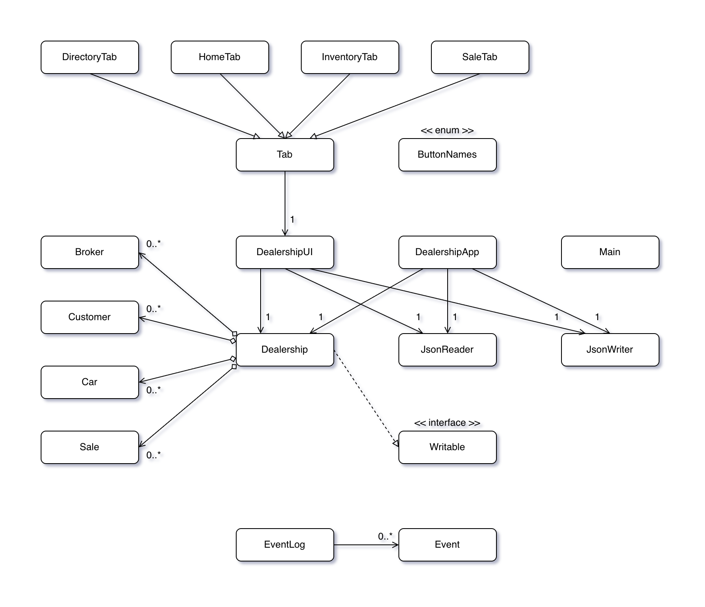

# DealerDesk

DealerDesk is a Java desktop app for dealership staff to manage cars, customers, brokers, and sales records. It includes a Swing GUI, a console entry point, JSON persistence, event logging, and JUnit tests.

## Features

- Add cars to inventory and update their status.
- View inventory, sales, brokers, and customers in separate tabs.
- Record sales by linking a car, customer, broker, and sale price.
- Save and load dealership data from `data/dealership.json`.
- Print event log entries when the GUI closes.

## Tech Stack

Java, Java Swing, `org.json`, JUnit 5, and Checkstyle.

## Design Diagram



## Getting Started

Requires JDK 11 or newer. To run from the terminal, create the `bin` folder, compile the source files with `javac --release 11 -cp "lib/*" -d bin $(find src/main src/test -name "*.java")`, then start the GUI with `java -cp "bin:lib/*" ui.DealershipUI`.

To run the console version instead, use `java -cp "bin:lib/*" ui.Main`.

On Windows, use `;` instead of `:` in classpaths.

## Saved Data

Main application data is stored in `data/dealership.json`. Test fixtures are stored in `data/test*.json`.

## User Stories

- As a user, I want to be able to add a car to the inventory with its model, color, and package.
- As a user, I want to be able to view the inventory/sale/broker/customer list.
- As a user, I want to be able to update the car status.
- As a user, I want to be able to record a sale by marking a car as sold and link it to a buyer and broker.
- As a user, when I select the quit option from the application menu, I want to be reminded to save car list to file and have the option to do so or not.
- As a user, when I start the application, I want to be given the option to load car list from file.

## Instructions for End User

- Click "Load" in the Home tab to load sample data.
- Use the Inventory tab to view cars, add a new car, or edit status.
- Use the Sale tab to record a sale and trigger the visual component.
- Use the Directory tab to view brokers and customers.
- Use "Save" and "Load" in the Home tab to persist or reload data.

## Event Log Example

Example event log output after adding a car, updating its status, and recording a sale. Events generated by JSON loading are omitted.

```text
Wed Nov 26 19:38:11 PST 2025  
New car #16 added into dealership.

Wed Nov 26 19:38:17 PST 2025  
Car #16 status updated to In stock

Wed Nov 26 19:38:39 PST 2025  
Car #16 status updated to Sold

Wed Nov 26 19:38:39 PST 2025  
Assigned customer #5 to broker #2

Wed Nov 26 19:38:39 PST 2025  
New sale record of car #16 added into dealership.
```

## Future Improvements

- Replace integer car statuses with a `CarStatus` enum to remove magic numbers.
- Introduce a shared ID generator for cars, brokers, and customers to reduce collision risk after loading data.
- Extract shared broker/customer fields into an abstract `Person` class.
- Replace broker customer ID storage with object associations managed by `Dealership`.
